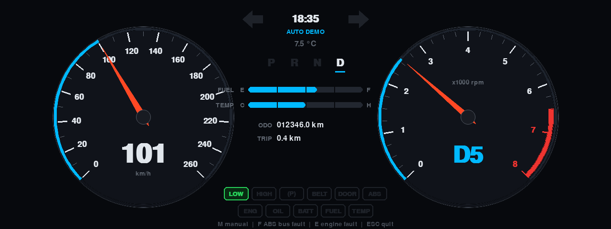
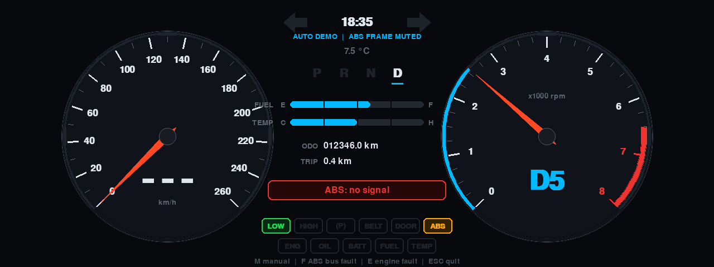

# Digital Instrument Cluster

A digital car dashboard (Kombiinstrument) that shows vehicle data received over **CAN**.
Every value on screen is decoded from CAN frames defined in a **DBC** file. Nothing is
passed to the display directly, just as in a real cluster ECU.



## Architecture

```
 ┌──────────────── simulated ECUs ────────────────┐        ┌──────────── cluster ECU ─────────────┐
 │ VehicleSim  (longitudinal model, 6-speed AT,   │        │ CanRx ── decode (cantools, DBC)       │
 │              flasher, fuel, coolant)           │  CAN   │   │                                   │
 │ DemoDriver / ManualDriver (keyboard)           │ ─────▶ │ SignalStore: timeout + alive counter  │
 │ CanTx: cyclic send  ABS 20 ms · ECM 20 ms ·    │ frames │   │                                   │
 │        BCM 100 ms, alive counters, clamping    │        │ logic.build_view: telltales, messages │
 └────────────────────────────────────────────────┘        │   │                                   │
          python-can: virtual bus  or  SocketCAN vcan0     │ Dashboard (pygame): gauges, HMI       │
                                                           └───────────────────────────────────────┘
```

| CAN ID | Message            | Sender | Cycle  | Signals |
|--------|--------------------|--------|--------|---------|
| 0x100  | `ABS_VehicleSpeed` | ABS    | 20 ms  | VehicleSpeed (0.01 km/h), ABS_Fault, alive counter |
| 0x101  | `ECM_Engine`       | ECM    | 20 ms  | EngineSpeed, CoolantTemp, FuelLevel, GearSelector (PRND), ActualGear, CheckEngine, OilPressureLow, ChargingFault, alive counter |
| 0x200  | `BCM_Body`         | BCM    | 100 ms | Turn lamps, low/high beam, door, seat belt, parking brake, outside temp, odometer |

## Features

- Speedometer and tachometer with redline, damped needles and digital speed readout
- Gear display (P R N D + engaged gear, e.g. `D4`), fuel and coolant bars, odometer/trip, outside temperature
- 11 telltales with ISO-style colours (red = critical, amber = warning, green/blue = info) and flashing turn indicators
- **Start-up lamp test and needle sweep**, like a real cluster at ignition on
- **Communication monitoring:** each message has a timeout (about 10× its cycle time). Stale signals are shown as `- - -`, needles drop to zero, and the matching warning lamp comes on (lost ABS frame → ABS lamp + "ABS: no signal")
- **Alive counter check** on safety-relevant frames (counts sequence jumps)
- Driver messages with priority (red before amber), e.g. *Release parking brake* when driving with the parking brake on
- Seat-belt reminder: steady at standstill, flashing above 20 km/h
- Fault injection while running: mute the ABS frame, set an engine fault



## Run

```bash
pip install -r requirements.txt
python -m cluster.app           # drive it yourself with the keyboard
python -m cluster.app --demo    # automatic demo drive cycle
```

| Key | Action |
|-----|--------|
| `W` (hold) | accelerate |
| `S` (hold) | brake |
| `P` `R` `N` `D` | gear selector. P and R only work below 5 km/h, like a real shift lock |
| `Q` / `E` | left / right indicator (press again to switch off) |
| `H` | high beam |
| `B` | parking brake |
| `C` / `O` | seat belt / door (to test the warnings) |
| `M` | switch between keyboard driving and the automatic demo |
| `F` | mute / unmute the ABS speed frame (bus fault) |
| `X` | toggle the engine fault (check engine) |
| `ESC` | quit |

To drive off: press `D`, then hold `W`.

### On a real (virtual) CAN interface: Linux / WSL2

```bash
sudo modprobe vcan && sudo ip link add dev vcan0 type vcan && sudo ip link set up vcan0
python -m cluster.app --interface socketcan --channel vcan0
candump vcan0                                       # watch the frames in a second terminal
```

With `--no-sim` the cluster only displays. You can feed it from any other CAN source
(another script, `canplayer`, or a real ECU behind a USB-CAN adapter).

## Tests

```bash
SDL_VIDEODRIVER=dummy pytest -q
```

21 tests cover: the DBC layout and signal resolution, cycle times on the bus, end-to-end
sim → CAN → cluster values, timeout/invalid handling, alive counter jumps, out-of-range
clamping, telltale and message rules, gauge geometry, the vehicle model, and a headless
smoke run of the full app. GitHub Actions runs them on every push.

## Project layout

```
dbc/vehicle.dbc        CAN database (messages, signals, scaling, value tables)
cluster/config.py      cycle times, timeouts, limits, thresholds
cluster/vehicle_sim.py vehicle model + demo/manual drivers (the "other ECUs")
cluster/can_io.py      cyclic transmitter and non-blocking receiver
cluster/signals.py     signal store with timeout and alive-counter monitoring
cluster/logic.py       HMI rules: telltales, gear text, driver messages (pure, tested)
cluster/gauges.py      gauge geometry and needle damping
cluster/dashboard.py   pygame rendering
cluster/app.py         main loop and CLI
```

## Roadmap

- Qt/QML front end (common in production clusters) on the same CAN/signal layer
- Replay of recorded CAN logs (`.asc` / `.blf`)
- Night/day themes and selectable display modes
